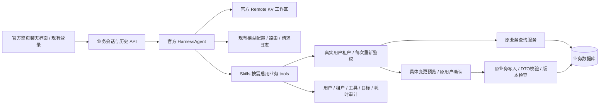

# AI 中台独立产品分支

分支：前后端 `feature/AI-HUB-20261025`。基线：后端 `5e77cde`、前端 `9397de3`。
普通业务产品保留在 `feature/ENTERPRISE-AGENT-20261024`；AI 中台的重构不回写原产品。

## 2026-10-26 接入方式修正

用户明确要求使用官方 Harness 的 Remote KV 无 Shell 模式，直接接入现有 Java 应用，不自行构建 Runtime。
据此移除试做的独立 `agent-worker`、NDJSON 执行协议、回调授权协议、远程状态传输和容器中继。
当前实现直接调用官方 AgentScope Java 2.0.3：

- `HarnessAgent` 负责模型/工具循环、Skills、Plan Mode、任务列表和上下文恢复。
- `RedisDistributedStore` + `RemoteFilesystemSpec` 负责原生远程 KV 工作区；`IsolationScope.SESSION` 隔离会话。该官方模式的底层文件系统没有 Shell 能力。
- 现有加密 `AgentStateStore` 通过 SDK 的标准存储接口保留历史状态，避免把旧会话丢掉；它覆盖 DistributedStore 的默认会话存储。
- `AgentScopeBinding` 只配置官方 SDK、转换公开事件和传递用户取消信号，不实现 ReAct 循环、模型调度器或自定义 Runtime 协议。
- 接入代码归入现有 `system-agent`，没有额外的 Engine/Worker 模块、独立服务或部署协议。
- 系统侧代码保留真实身份绑定、逐次权限校验、原业务服务 tools、具体变更确认、业务审计和现有模型配置/日志桥接。
- 不使用 Docker、Shell、主机文件操作作为业务执行方式。SDK 的隐式网页工具也不开放。

官方依据：
- [2.0.3 Filesystem](https://github.com/agentscope-ai/agentscope-java/blob/v2.0.3/docs/v2/en/docs/harness/filesystem.md)
- [2.0.3 RedisDistributedStore](https://github.com/agentscope-ai/agentscope-java/blob/v2.0.3/agentscope-extensions/agentscope-extensions-redis/src/main/java/io/agentscope/extensions/redis/RedisDistributedStore.java)

## 调用关系

Agent 提示词不人工拼接数据库引用；模型与 Agent 提示词仍在现有配置中心管理。
Remote KV 无 Shell 是 SDK 的能力边界，不应宣传为同一 Java 进程内的物理网络隔离；业务数据库只由系统服务访问，不给模型 SQL、连接信息或任意 HTTP/反射工具。

## 功能与复用

- 原生 `ClasspathSkillRepository` + `SkillToolGroup` 延迟发送工具 schema。加载 Skill 后使用官方 `reset_equipped_tools` 启用对应组。
- 已接入十五类业务域，详见 [API 接入清单](AI-HUB-API-COVERAGE.md)。新发布的业务表单自动进入资源目录。尚不能声称几乎所有 API 均已接入。
- 写工具生成并持久化具体预览，等待真实用户确认；等待不持有数据库事务。确认后返回真实回执给官方 Agent，继续后续步骤；拒绝、失败、取消和超时不算完成。
- 原生 DTO 校验、同事务幂等收据、现有租户/记录范围、确认前版本/快照检查。Native 管理对象确认时加固定记录锁；不接受模型指定表名或 SQL。
- 用户局部修改在业务侧保留未修改的联系方式；给模型的手机号和邮箱仍脱敏，不将脱敏值回填原字段。
- 前端嵌入 `@agentscope-ai/chat@1.1.72` 的完整 `AgentScopeRuntimeWebUI`；协议适配接入现有登录、会话、图片、取消和重连。任务进度和业务确认使用 Ant Design 成熟组件。

## 证据与未完成项

2026-11-01 真实模型验收发现并修复：

- 保留官方 `plan_exit` 工具，使用 SDK 权限上下文阻止模型自行批准计划；用户下一轮选择执行后才解除只读模式。
- SDK 2.0.3 的计划中间件捕获构建时的 Toolkit，元工具又在 ReAct 阶段重新注册。接入层仅补齐元工具的只读元数据，保留原生 Skill/工具组激活，不实现另一套循环。
- 已停用工具组的历史调用仍合法；当前新输出依旧只能调用本轮实际提供的工具。
- 模型的首次输出等待预算为备用模型留时间；已开始的响应使用完整配置时限，不因备用数量增加而被提前截断，仍不重放已输出的请求。
- DNS 解析到保留地址继续阻止连接，分类为网络失败，允许按现有策略兜底。QA 沿用本机现有 HTTP 代理，未取消地址或 TLS 校验。

真实 PLAN 任务“帮我新增一个绿色保温杯，39元，先做个计划。”已完成并停留在等待用户执行的状态。随后独立执行任务通过真实页面确认新增商品，原业务写入及 Agent 继续回答均通过，详见 [本轮验收记录](AI-HUB-ACCEPTANCE-20261101.md)。以下旧记录保留其原验收日期，不能视为本次完整链路通过的证据。

2026-10-26 本地验证：

- 干净执行全部 135 个必需测试类（705 项）和真实 Redis 原生 KV 测试（1 项），合计 706 项通过，无失败、错误或跳过；`Verify-Build.ps1` 和 AI 测试分类检查通过。
- 真实 Redis 测试重新创建官方 Harness 后可读取原计划及上下文，另一会话无法读取；工具注册表没有 Shell/execute。使用固定的虚构模型响应，未调用外部供应商。
- 后端可执行 Jar 已构建；使用官方 AgentScope 2.0.3，保留应用原有 Redisson 3.40.2，排除 SDK 未使用的 Redisson/Lettuce 传递依赖。
- 前端适配器/历史测试 11 项通过，类型检查、ESLint 和标准 Turbo 生产构建通过；构建时需给予 Node 足够内存，3 GiB 堆上限不足，本次使用 6 GiB。
- 可执行 Jar 在独立 QA MySQL/Redis 启动成功，49 个迁移校验通过并应用新增的 501 审计迁移。正常账号登录后，生产构建中的官方整页聊天、历史会话、图片入口、计划/执行及场景选择加载成功，浏览器错误为 0。
- 本轮没有发送新的外部模型请求；上述启动/页面检查不能替代真实模型任务及确认后继续执行的端到端验收。

KV 环境：本地验证使用独立 Redis 5.0.14.1；CI 使用 Redis 7。旧 Windows Redis 3.2 不支持 SDK 原生 Lua 所用的多字段 HSET，不能作为此接入的运行环境；没有为旧版 Redis 自建兼容执行层。应用直接复用 `spring.data.redis` 的连接设置，不需要额外 Worker 地址或密钥。

具体测试结果以工作区 `output/ai-hub-required-tests.log`、`output/ai-hub-adapter-tests.log` 及 Surefire XML 为准；旧 Worker HTTP 测试不再用于当前方案的完成证明。

目前已有源代码和定向测试，整体目标尚未完成。仍需：

1. 核验打包后 Skills 实际加载和模型任务的完整页面链路；应用启动、迁移、原生 KV 存取及 SDK 跨实例会话恢复已通过。
2. 完成官方聊天页侧栏搜索/重命名、中文交互、计划到执行和用户确认后的真实页面验收。
3. 扩大业务 API 的 Skills/tools 覆盖，列出明确排除的认证、凭据及内部接口。
4. 完成新分支 AI 中台入口/首页与普通产品分支的差异化处理。
5. 对完整产品目标逐项完成审计；本轮接入代码已在前后端分支分别做最小完整提交，后端完整必需回归和前端生产构建已通过。
